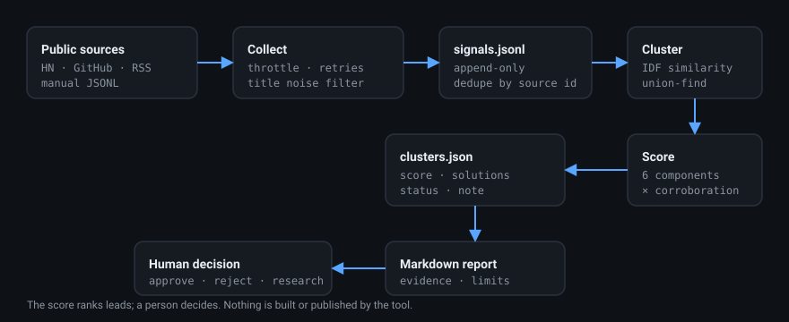

# Problem Radar

A dependency-free Python tool that collects **public** problem signals, groups them, scores the
opportunities with an explainable rationale, and writes a report a human can act on.

It is a radar, not an oracle: the score ranks leads, and every claim links to its public evidence.



## Why

Building a tool for a problem nobody has is the most expensive mistake in software. Public issue
trackers, forums and feeds contain the raw material — repeated complaints, error messages, missing
features — but they are noisy, duplicated, and weighted by whoever shouts loudest.

Problem Radar does one narrow job: turn a bounded harvest of public text into a ranked, sourced list
of problems, with the *reason* for the rank written next to it.

## What it does

```text
public sources (HN, GitHub issues, RSS, manual)
        ↓  collect      ← rate limited, user-agent, caps, title-level noise filter
data/signals.jsonl       ← append-only, one JSON object per signal, deduplicated
        ↓  cluster      ← IDF-weighted similarity, union-find
data/clusters.json       ← problems, their evidence, their score, their human state
        ↓  score        ← six observable components + solution penalties
reports/YYYY-MM-DD-problem-radar.md
```

## Quick start

```bash
git clone https://github.com/TKonate/problem-radar.git
cd problem-radar
pip install -e .          # optional: installs the `radar` command

radar init .              # writes config/radar.json, data/, reports/
radar collect             # public APIs only, no key required
radar cluster             # group + score
radar report              # Markdown report in reports/
```

Nothing else to install: the tool uses the Python 3.10+ standard library only. Without `pip install`,
use `python -m problem_radar ...`.

## Commands

| Command | What it does |
|---|---|
| `radar init [path]` | Create `config/radar.json`, `data/` and `reports/` |
| `radar collect` | Run the enabled collectors (`--source`, `--limit`, `--dry-run`) |
| `radar cluster` | Re-cluster and re-score the stored signals |
| `radar report` | Write the Markdown report (`--top`, `--output`, `--json`) |
| `radar run` | `collect` + `cluster` + `report`, cron friendly |
| `radar sources` | Show the configured sources, tiers and limits |
| `radar list` | List clusters (`--status`, `--recommendation`, `--min-score`, `--json`) |
| `radar show <id>` | One cluster: score breakdown, evidence, solutions (`--json`) |
| `radar status <id> <status>` | Move a cluster through the pipeline (`--note`, `--force`) |
| `radar solution <id> --status ...` | Record what a solution search concluded |
| `radar add --title ... --url ...` | Add a manual signal, no network |
| `radar export <path>` | Export clusters and signals as one JSON document |

## The score

Six observable components, then a corroboration factor and solution penalties:

| Component | Weight | What it measures |
|---|---|---|
| volume | 25 | number of independent signals (logarithmic, saturates at 10) |
| diversity | 20 | number of distinct source families (saturates at 4) |
| recency | 15 | age of the most recent signal (90-day half-life) |
| severity | 15 | distinct pain words, whole-word matched (saturates at 4) |
| evidence | 10 | completeness of URL, author, date and quote |
| confidence | 15 | reliability of the source family |

Then:

- **corroboration** multiplies the subtotal: ×0.55 for one signal, ×0.75 for two, ×0.90 for three,
  ×1.00 from four. A single well-formed bug report must not outrank a problem reported five times.
- **solution penalties**: an existing adopted solution costs 30 points, a poorly documented one 8.

Every report prints each line of the calculation. Thresholds default to
`ignore < 30 ≤ watch < 45 ≤ research < 65 ≤ submit`, configurable in `config/radar.json`.

**What the score does not measure**: demand, willingness to pay, feasibility, cost, legal risk,
strategic interest, or the absence of a solution (that is a separate human research step). See
[docs/methodology.md](docs/methodology.md).

## Sources

| Source | Kind | Tier | Notes |
|---|---|---|---|
| Hacker News | `hackernews` | social (0.35) | Public Algolia API, no key |
| GitHub issues | `github` | issue-tracker (0.85) | Public search API, `GITHUB_TOKEN` optional |
| RSS / Atom | `rss` | blog (0.55) | Any feed, parsed with the standard library |
| Manual | `manual` | unknown (0.25) | JSONL file or `radar add` |

Rules: documented endpoints only, no scraping and no login, one request at a time per host
(6 s for GitHub search, 1 s elsewhere), explicit `User-Agent`, `limit` per query, 1 MiB response cap,
and bodies stored as a 2 000-character excerpt (data minimisation).

`GITHUB_TOKEN` (read-only) raises the unauthenticated 10 requests/minute search limit. It is read
from the environment and never written to the configuration or the data files.

## Configuration

```json
{
  "storage": { "data_dir": "../data" },
  "cluster": { "threshold": 0.30, "max_signals": 2000 },
  "report": { "top": 15, "output_dir": "../reports" },
  "scoring": {
    "weights": { "volume": 25, "diversity": 20, "recency": 15, "severity": 15, "evidence": 10, "confidence": 15 },
    "thresholds": { "submit": 65, "research": 45, "watch": 30 }
  },
  "sources": [
    {
      "name": "hackernews",
      "kind": "hackernews",
      "tier": "social",
      "enabled": true,
      "limit": 20,
      "queries": ["Ask HN", "alternative to", "keeps crashing"]
    },
    {
      "name": "github",
      "kind": "github",
      "tier": "issue-tracker",
      "enabled": true,
      "limit": 20,
      "queries": ["\"model not found\" is:issue is:open comments:>3"]
    }
  ]
}
```

Relative paths are resolved from the configuration file, so `radar` works from any directory.
`radar sources` prints what is actually enabled.

## The pipeline states

`discovered → clustered → researched → proposed → approved → rejected | built → deployed`

Transitions are validated (`radar status`); `--force` exists for the rare legitimate exception.
`rejected` can be reopened to `clustered`. Human state — status, note and solution checks — survives
re-clustering: it is matched back by signal overlap or exact title.

## A real run

`reports/2026-11-18-problem-radar.md` is the output of the first harvest committed with the
repository: **68 signals** (42 Hacker News, 26 GitHub issues, 0 from the RSS feed after filtering),
**67 clusters**, top score **35.7/100 — watch**. All clusters are single-signal: one harvest of 68
items does not contain a corroborated problem, and the tool says so instead of inventing one.
Recurrence appears across runs, when a second harvest adds signals to the same clusters.

The report is committed as evidence of what the tool produces, not as a business recommendation.

## Project structure

```text
problem_radar/
├── cli.py          argparse, subcommands, exit codes
├── config.py       configuration loading and validation
├── models.py       Signal, Cluster, Solution, Score, pipeline states
├── sources.py      HTTP client (throttle, retries) and the four collectors
├── text.py         normalisation, keyword taxonomy, problem extraction, noise filter
├── dedupe.py       IDF-weighted similarity and union-find clustering
├── scoring.py      explainable opportunity score
├── pipeline.py     collect → store → cluster → score
├── report.py       Markdown report and JSON export
├── store.py        JSONL signals, clusters, human state carry-over
└── taxonomy.py     domains, categories, source tiers, severity words
tests/              168 tests, fixtures recorded from the real APIs
config/radar.json   the configuration used for the committed run
data/               signals.jsonl + clusters.json from that run
reports/            the generated report
docs/               methodology, taxonomy, decisions
```

## Development

```bash
python -m venv .venv && source .venv/bin/activate
pip install -e ".[dev]"
pytest -q
ruff check . && ruff format --check .
mypy
```

Coverage is 94 %; CI runs the suite on Python 3.10 to 3.13 with lint, formatting, typing and a 90 %
coverage floor.

## Design decisions

- **Standard library only.** A radar that needs a vector database to run on a 4-vCPU VPS will not run
  on a 4-vCPU VPS.
- **JSONL + JSON.** Every intermediate state is readable with `cat` and diffable with `git`.
- **Rules, not models.** Clustering is IDF-weighted token similarity; extraction is regex and
  keywords. It is inspectable, reproducible and cheap — and its failures are explainable.
- **The title is the problem.** Search APIs match bodies, so body-based filtering lets a changelog
  through whenever it mentions "rate limit".
- **No decision automation.** Nothing is created, published or merged without a human; the tool stops
  at a report.

## Limits

- A single harvest measures *what was said this week*, not a market.
- Keyword taxonomies miss problems phrased without the expected words (recall is deliberately traded
  for precision).
- GitHub issue search is rate limited and its relevance is uneven; targeted queries beat broad ones.
- Feeds and APIs change: a broken collector is reported, never silently skipped.

## License

MIT
